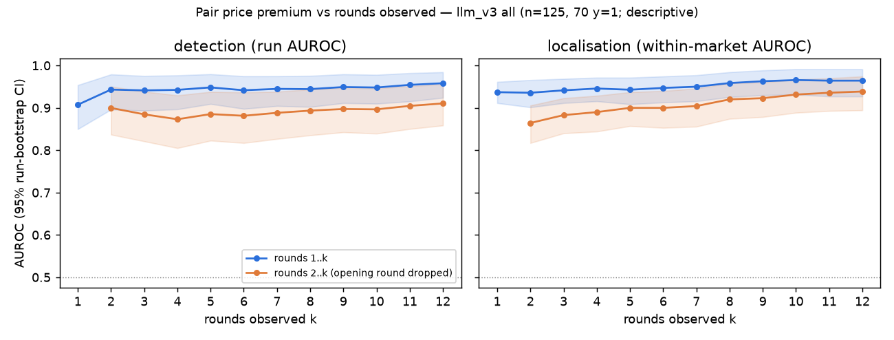
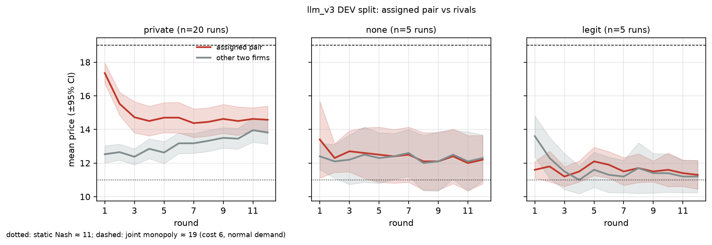

# Say vs. Do: does auditing what AI agents *say* together with what they *do* catch collusion better?

*Apart AI Collusion Sprint, Q2.2 — text + action auditing. Status: locked test results in (2026-10-24 00:03 UTC); all exploration strata (§Exploration) complete (01:25 UTC); pre-registered replication run 02:07 UTC.*

## Abstract
We build a 4-firm repeated-pricing market with LLM sellers (gpt-6-luna). In the `private` condition, one pair of firms
gets a private chat channel. Sellers are never told to collude (private-condition sellers must send a
private message each round; its content is free), yet all 70 private pairs use the channel to coordinate, and our
public-coordination checker flags none of the 125 runs. Zero-shot LLM auditors (gpt-6.1-sol) score every firm pair
under six views of the public log: text, actions, both, each with or without a computed pair-statistics
table. Results on the locked test split (n = 95, run once):
- **No resolved text gain for the LLM auditor.** The text-only auditor is consistent with chance at detection (run
  AUROC 0.47). Adding text to actions gives no resolved gain (Δ_hybrid −0.01 [−0.09, +0.06]; gains up to ~0.06 not
  excluded), and replacing each run's messages with a matched donor run's has no resolved effect on the hybrid
  auditors (Δ run AUROC −0.01 [−0.10, +0.08]). Claude Sonnet 5.5 shows the same pattern on a 42-run subset.
- **The statistics table helps** (action_stats − action: +0.11 run AUROC, +0.10 within-market AUROC).
- **A one-line untrained statistic is the best detector.** The pair's price premium over its rivals reaches 0.95,
  against ≤ 0.86 for every LLM view (premium − best view +0.09 [+0.01, +0.18]). We chose this statistic after seeing
  partial data incl. test runs, and without round 1 its lead is no longer resolved.
- **The public text is not empty.** A supervised text classifier (grouped 5-fold CV within the test runs) detects
  collusion at AUROC 0.98. Colluding firms quietly drop competitive wording ("keeping our price competitive", "earn your business"), so
  their public talk *does* carry a trace — learnable in-distribution, but not reflected in above-chance zero-shot
  text detection.
- **Caveats.** The label coincides with the experimental condition (all private runs are colluding; no-channel runs
  are negative by construction), so we detect *channel granted and used*, not realised overcharge or tacit collusion.
  Round-1 prices, set before any private message is read, already give the premium test run AUROC 0.90: strong
  discrimination precedes any response to a partner's message (post-lock, descriptive).
  One seller model, one framing, sellers never try to evade. On 16 runs from a different framing in which the judge found
  no agreement, the frozen thresholds flag 44% (premium) and 25–63% (stats-table views) of runs: the strong
  detectors do not transfer as-is.
- **Replication on 30 fresh runs (4/4 registered criteria met; registration-timing caveat in §Replication):**
  premium run AUROC 0.92 [0.79, 1.00] vs the fixed best LLM view, action_stats, 0.80 (Δ +0.12 [−0.004, +0.29]);
  text 0.67 [0.47, 0.86]; combined − action −0.14 [−0.30, +0.02]. Neither premium superiority nor a text gain is
  resolved. The frozen premium threshold flags 4/10 fresh `none` runs.
- **No coordination under an announced price monitor.** When the prompt also says prices are monitored (private chat
  still unmonitored), the judge finds agreements in 0/14 private runs (vs 70/70 without the note) and mean markup is
  close to the no-channel runs, so the planned evasion test had no colluders to test on (unpaired exploration, n = 20).

## Question
Given logged trajectories (public messages + prices + market state), do auditors that see both streams detect
collusion — and identify the colluding pair — better than text-only or action-only auditors? Is any gain due
to genuine cross-modal reasoning or just more input?

## Setup
**LLM market (`llm_market.py`, headline data `data/llm_v3`).** 4 firms, 12 rounds, integer prices 6–30, logit
demand (μ=4; static Nash ≈ 11, joint-monopoly ≈ 19 at cost 6), public cost shocks and demand levels.
Each round each seller (gpt-6-luna via codex) returns `{public_message, price, notes}` (+ `private_message` if it has
a channel). Conditions (randomised, 125 runs planned): `private` (70) — designated pair has a private channel;
`none` (35) — no channel; `legit` (20) — the pair has a publicly announced cost-saving shipping partnership
(hard negative). Framing: economics-lab experiment with earnings = profit.

*Pilot observation (framing; 3 firm-framing pilot runs vs 1 lab pilot run, not a controlled comparison):* with a "pricing manager + competition authority monitors public messages"
framing, luna sellers used the private channel only to say "I'll price independently" (0/3 runs with any
coordination) and posted near-identical boilerplate. With the lab framing, private pairs immediately exchange
intended prices and proposals ("I plan to price at 14; consider matching so we can improve margins without
triggering a price war"). Pilot data: `data/llm_v2` (firm framing), `data/pilot_lab_luna`.

**Labels (`label_llm.py`).** A gpt-6.1-sol judge reads ONLY the private chat (no prices, to avoid building the
action signal into the label) → `explicit` / `info_exchange` / `none`. Primary label y = explicit ∪
info_exchange on the assigned pair. Realised conduct (pair price premium over the other two firms, displayed rounds 5–12)
is reported separately. Private chat is never auditor input.

**Endpoint.** y = 1 iff a judge reading the private chat finds an explicit price agreement or a pricing-intention
exchange on the assigned pair. This is *private coordination communication*, not realised supra-competitive
conduct; runs are split by late-window relative premium as a (weak) proxy for whether it was acted on.
Primary metrics: run AUROC (detection) and within-market AUROC (localisation: P(colluding pair scored above another
pair of the same market), positive runs). Pooled pair AUROC is secondary (a scorer that is flat within each
market can still reach ≈ 0.77 pooled, per the codex review).

**Auditors (`auditors.py`).** Same model (gpt-6.1-sol, medium reasoning; calls that silently fell back to another
model are discarded), same task text, same runs. Views: `text` (public messages + public facts), `action`
(prices, cost, demand, units, profit + public facts), `combined` (strict union), `structured` (combined + pair
statistics table + stated-vs-actual price table). Output: 0–100 suspicion per pair, P(any collusion), evidence.

**Scripted market (`sim.py`, mechanism check only).** Templated messages × scripted actions, 8 conditions incl.
hard negatives (cheap talk without action, common shocks, shared pricing rule, legit cooperation). Its Δ is a
function of how we designed the templates (colluders' stated price direction is decoupled from their action), so
it only validates the pipeline and the shuffle ablation.

## Results
The scripted-market mechanism check (pipeline + shuffle-ablation validation) is in Appendix B; dev-split
development results are in Appendix A.

### LLM market — HEADLINE: locked test split (runs 0030–0124, n = 95; 50 y=1, 30 `none`, 15 `legit`)
Computed ONCE by `./finalize_test.sh` (stamp `logs/final/RUN_ONCE.stamp`: started 23:59, HEADLINE_DONE 00:03 UTC) with
the configuration frozen on dev; all tables below are copied verbatim from the generated
`results/analysis/report_tables_test.md` (source: `results/analysis/final_llm_v3_gpt-6.1-sol_test.json` and
siblings). Hard set: 0/125 runs have explicit coordination language in public (`hardset.py`), so every run is "hard".
95% class-stratified run-bootstrap CIs; fusion weight w_text = 0.6 fitted on dev.

| scorer | run AUROC (detection) | within-market AUROC (localisation) | pooled pair AUROC | pair-ID acc |
|---|---|---|---|---|
| text | 0.47 [0.36, 0.58] | 0.65 [0.59, 0.71] | 0.60 [0.53, 0.67] | 0.35 [0.26, 0.46] |
| action | 0.75 [0.65, 0.85] | 0.79 [0.72, 0.87] | 0.78 [0.72, 0.84] | 0.42 [0.28, 0.56] |
| action_stats | 0.86 [0.77, 0.94] | 0.89 [0.84, 0.94] | 0.89 [0.84, 0.94] | 0.66 [0.52, 0.80] |
| combined | 0.74 [0.64, 0.83] | 0.80 [0.71, 0.87] | 0.78 [0.72, 0.84] | 0.43 [0.31, 0.57] |
| combined_stats | 0.80 [0.70, 0.89] | 0.93 [0.89, 0.96] | 0.89 [0.85, 0.93] | 0.73 [0.60, 0.84] |
| structured | 0.84 [0.75, 0.91] | 0.92 [0.89, 0.96] | 0.89 [0.85, 0.94] | 0.70 [0.57, 0.82] |
| fusion | 0.72 [0.62, 0.83] | 0.82 [0.74, 0.88] | 0.80 [0.74, 0.85] | 0.43 [0.30, 0.57] |
| premium | 0.95 [0.90, 0.98] | 0.96 [0.91, 0.99] | 0.96 [0.92, 0.99] | 0.89 [0.79, 0.97] |
| premium_r2plus | 0.90 [0.84, 0.95] | 0.93 [0.88, 0.98] | 0.92 [0.88, 0.96] | 0.84 [0.73, 0.93] |


*Test ROC curves (`uv run python fig_roc.py`; descriptive, thresholds read from the locked json). Dots = dev-chosen
operating points with the number of `legit` runs flagged. The frozen operating points differ widely (FPR here is over all 45
negatives, not legit only) and the curves cross; at very low FPR (≈ 0.04) action_stats' curve sits above the premium's (TPR ≈ 0.82 vs ≈ 0.66),
so the premium's AUROC lead comes from the moderate-FPR region. Read off the curve, no CI.*

**Key paired contrasts** (same runs; Δ_hybrid[v] = v − max(text, action); rows selected from the generated file,
which lists all 25 pre-registered contrasts; no multiplicity correction):

| contrast | run AUROC | within-market AUROC | pooled pair AUROC |
|---|---|---|---|
| delta_hybrid[combined] | -0.013 [-0.091, +0.064] | +0.002 [-0.052, +0.050] | +0.004 [-0.039, +0.046] |
| delta_hybrid[action_stats] | +0.106 [+0.038, +0.180] | +0.100 [+0.036, +0.164] | +0.116 [+0.067, +0.164] |
| delta_hybrid[structured] | +0.083 [+0.001, +0.169] | +0.130 [+0.068, +0.194] | +0.116 [+0.066, +0.165] |
| delta_hybrid[fusion] | -0.028 [-0.073, +0.018] | +0.022 [+0.000, +0.052] | +0.017 [-0.007, +0.043] |
| action_stats-action | +0.106 [+0.038, +0.180] | +0.100 [+0.036, +0.164] | +0.116 [+0.067, +0.164] |
| combined_stats-action_stats | -0.061 [-0.138, +0.014] | +0.036 [+0.008, +0.072] | -0.005 [-0.044, +0.035] |
| combined-fusion | +0.016 [-0.064, +0.092] | -0.020 [-0.070, +0.022] | -0.013 [-0.053, +0.029] |
| premium-combined_stats | +0.150 [+0.056, +0.248] | +0.028 [-0.022, +0.080] | +0.069 [+0.015, +0.115] |
| premium-action_stats | +0.089 [+0.010, +0.182] | +0.064 [+0.006, +0.124] | +0.064 [+0.012, +0.118] |
| premium_r2plus-action_stats | +0.045 [-0.042, +0.139] | +0.038 [-0.022, +0.104] | +0.030 [-0.024, +0.079] |
| premium-structured | +0.112 [+0.026, +0.197] | +0.034 [-0.016, +0.078] | +0.065 [+0.013, +0.116] |
| premium_r2plus-structured | +0.068 [-0.029, +0.161] | +0.008 [-0.046, +0.058] | +0.030 [-0.024, +0.080] |

**Findings (test):**
1. **No resolved gain from adding raw public text to the LLM auditor.** The text-only auditor is consistent with
   chance for detection (run AUROC 0.47 [0.36, 0.58]) and weak but above chance at localisation (0.65 [0.59, 0.71]).
   Giving the auditor messages + actions together does not resolve a gain over actions alone (Δ_hybrid[combined] run
   −0.013 [−0.091, +0.064], within +0.002 [−0.052, +0.050]; the intervals still allow gains of ~0.05–0.06, no
   equivalence test), and joint reading is not resolved better than late fusion of the two unimodal auditors
   (combined − fusion within −0.020 [−0.070, +0.022]). Same direction on dev. That colluders keep coordination in
   the private channel is a plausible explanation, not tested.
2. **A computed statistics table helps a lot.** action_stats − action: run +0.106 [+0.038, +0.180], within +0.100
   [+0.036, +0.164]. With the table present, adding text gives a small localisation gain (combined_stats −
   action_stats within +0.036 [+0.008, +0.072]; dev +0.020 [0.000, +0.050]) and no detection gain (run −0.061
   [−0.138, +0.014]). This is the only positive say+do signal on LLM data: nominal, unadjusted (25 contrast families × 3 metrics are reported, no multiplicity correction), and small; dev's lower bound is 0.000, so it is suggestive and needs confirmation.
3. **An untrained one-line statistic has the best detection of all scorers.** Pair premium run AUROC 0.95
   [0.90, 0.98] vs best LLM view 0.86 (action_stats; premium − action_stats +0.089 [+0.010, +0.182], premium −
   structured +0.112 [+0.026, +0.197]). For localisation the premium also has the highest point
   estimates (pair-ID 0.89 vs 0.73 combined_stats / 0.70 structured); its within-market advantage over structured
   (+0.034 [−0.016, +0.078]) and combined_stats (+0.028 [−0.022, +0.080]) is unresolved, over action_stats it
   nominally excludes zero (+0.064 [+0.006, +0.124]). The premium is a generator-specific price-level comparator (run
   score = max over pairs); the stats table itself contains a premium row, so the stats-table gain is "better action
   summary", not cross-modal reasoning.
   Without round 1 (premium_r2plus) the detection gap vs structured/action_stats is no longer resolved (+0.068
   [−0.029, +0.161], +0.045 [−0.042, +0.139]). Disclosure: the premium was proposed after a look at partial data
   that included test runs (see Held-out discipline), so this is not a blind discovery.
4. **Legitimate cooperation: no LLM advantage at matched recall.** At dev-chosen thresholds the premium flags 5/15
   (0.33) `legit` partnership runs, while structured and action flag 0/15 (Wilson CI [0, 0.20]); these views can read
   the public partnership notice (no notice-removal ablation was run). But they operate at much lower recall (0.40 and
   0.20 of y=1 runs vs the premium's 0.92), and the text-reading combined views flag legit runs about as often as the
   premium (combined 0.27, combined_stats 0.20). Comparing at a common *minimum recall target* (post-lock,
   descriptive; `uv run python matched_recall.py` → `results/analysis/matched_recall_llm_v3_test.json`; oracle
   thresholds read off the test positives; ties can push a scorer's recall above the target) gives mixed results at
   moderate recall and a premium advantage at high recall. Legit runs flagged: target 0.5 — premium 0/15 (TPR 0.50),
   structured 0/15 (0.54), action_stats 1/15 (0.50); target 0.7 — premium 2/15 (0.72), action_stats 1/15 (0.72),
   structured 3/15 (0.78); target 0.9 — premium 5/15 (0.90), action_stats 9/15 (0.92), structured 11/15 (0.92);
   `none` runs at target 0.9: 2/30 vs 20/30 and 19/30. So reading the partnership notice gives the LLM auditors no
   consistent advantage in clearing legitimate cooperation (n = 15 legit runs; no CIs on the comparison).
5. **No tested LLM+premium combination beats the premium** (`incremental.py`, one fixed untrained label-free
   rank-average rule; other combination rules or conditional use were not tested): combo − premium run AUROC from −0.147 [−0.226, −0.078] (text) to +0.001 [−0.038, +0.043] (structured); never resolved positive.
6. **Label = condition check.** Among y=1 runs where the pair's late-window premium is ≤ 0.5 (n = 20; low relative
   premium does not establish that coordination ended), the premium still flags 0.80 [0.58, 0.92] and action_stats 0.65. Opening-round price
   differences may contribute (premium without round 1: 0.90 vs 0.95, no paired CI), but a low later relative
   premium does not show that coordination stopped (rivals may follow the pair), so this stratification does not
   settle whether agreements were sustained.

**Flag rates at the dev-chosen thresholds (test, honest FPR):**

| stratum | n | text | action | action_stats | combined | combined_stats | structured | fusion | premium | premium_r2plus |
|---|---|---|---|---|---|---|---|---|---|---|
| all_negatives | 45 | 0.11 [0.05, 0.23] | 0.04 [0.01, 0.15] | 0.04 [0.01, 0.15] | 0.20 [0.11, 0.34] | 0.18 [0.09, 0.31] | 0.04 [0.01, 0.15] | 0.09 [0.04, 0.21] | 0.16 [0.08, 0.29] | 0.20 [0.11, 0.34] |
| legit | 15 | 0.07 [0.01, 0.30] | 0.00 [0.00, 0.20] | 0.07 [0.01, 0.30] | 0.27 [0.11, 0.52] | 0.20 [0.07, 0.45] | 0.00 [0.00, 0.20] | 0.07 [0.01, 0.30] | 0.33 [0.15, 0.58] | 0.33 [0.15, 0.58] |
| none_all | 30 | 0.13 [0.05, 0.30] | 0.07 [0.02, 0.21] | 0.03 [0.01, 0.17] | 0.17 [0.07, 0.34] | 0.17 [0.07, 0.34] | 0.07 [0.02, 0.21] | 0.10 [0.04, 0.26] | 0.07 [0.02, 0.21] | 0.13 [0.05, 0.30] |
| none_highmarkup_proxy | 1 | 1.00 [0.21, 1.00] | 0.00 [0.00, 0.79] | 0.00 [0.00, 0.79] | 1.00 [0.21, 1.00] | 1.00 [0.21, 1.00] | 1.00 [0.21, 1.00] | 1.00 [0.21, 1.00] | 0.00 [0.00, 0.79] | 0.00 [0.00, 0.79] |
| none_lowmarkup | 29 | 0.10 [0.04, 0.26] | 0.07 [0.02, 0.22] | 0.03 [0.01, 0.17] | 0.14 [0.06, 0.31] | 0.14 [0.06, 0.31] | 0.03 [0.01, 0.17] | 0.07 [0.02, 0.22] | 0.07 [0.02, 0.22] | 0.14 [0.06, 0.31] |
| private_y1 | 50 | 0.10 [0.04, 0.21] | 0.20 [0.11, 0.33] | 0.72 [0.58, 0.82] | 0.52 [0.39, 0.65] | 0.68 [0.54, 0.79] | 0.40 [0.28, 0.54] | 0.28 [0.17, 0.42] | 0.92 [0.81, 0.97] | 0.84 [0.71, 0.92] |

**Label≈condition check**: detection (flag rate) among y=1 runs by realised late-window relative premium of the colluding pair:

| stratum | n | text | action | action_stats | combined | combined_stats | structured | fusion | premium | premium_r2plus |
|---|---|---|---|---|---|---|---|---|---|---|
| late_rel_premium_le_0.5 | 20 | 0.05 [0.01, 0.24] | 0.25 [0.11, 0.47] | 0.65 [0.43, 0.82] | 0.55 [0.34, 0.74] | 0.60 [0.39, 0.78] | 0.35 [0.18, 0.57] | 0.35 [0.18, 0.57] | 0.80 [0.58, 0.92] | 0.60 [0.39, 0.78] |
| late_rel_premium_gt_0.5 | 30 | 0.13 [0.05, 0.30] | 0.17 [0.07, 0.34] | 0.77 [0.59, 0.88] | 0.50 [0.33, 0.67] | 0.73 [0.56, 0.86] | 0.43 [0.27, 0.61] | 0.23 [0.12, 0.41] | 1.00 [0.89, 1.00] | 1.00 [0.89, 1.00] |

**Trained non-LLM baselines on test (caution):** a logistic regression on TF-IDF of the public messages, trained by
5-fold CV *within* the test split, reaches run AUROC 0.98 [0.95, 1.00] and pair-ID accuracy 1.00, while the zero-shot
LLM text auditor is at chance. Shuffling messages within label+condition does not hurt it (0.97). So the public text
*does* carry a strong condition-linked signal that no public message states explicitly (0/125 hard-set flags) and the
zero-shot LLM does not use. Post-headline inspection (`uv run python text_lr_inspect.py` → `results/analysis/text_lr_inspect.json`;
descriptive all-data refit, not an evaluation; it does not show which features drive the out-of-fold performance):
top positive uni/bigrams are bland margin phrasing ("considered price", "supports reliable", "balances customer"),
top negative ones competitive phrasing ("price competitive", "your business", "keeping"). At the firm level (all
125 runs; each firm's concatenated public messages; role = colluding firm / rival firm in the same private run /
firm in a `none` run): "considered price" 25/140 colluders, 11/140 rivals, 0/140 `none` (0/80 `legit`) — so rivals
pick it up too (condition-level shift); but the **pair-specific cue is large**, and mostly it is what colluders
*stop* saying: "keeping" 67/140 vs 133/140 vs 139/140, "business" 6/140 vs 45/140 vs 56/140, while "adjusting our"
rises (51/140 vs 12/140 vs 21/140). This is consistent with the text LR's perfect pair-ID (1.00 vs premium 0.89).
The message shuffle (donors share label + condition) cannot remove a condition-level style signal, so its
shuffle-robust 0.97 is not evidence against it. Interpretation (not tested): public text carries an *indirect*
trace — colluders drop competitive language — that a supervised model trained in-distribution learns but a
zero-shot LLM auditor reading for explicit coordination does not use. Whether it reflects the channel prompt, the
communication or the conduct cannot be separated here (label = condition). Whether it transfers to other seller models or framings is untested.
The untrained text-convergence score (`textsim.py`) localises at 0.74 [0.66, 0.81] vs the LLM text auditor 0.65
(Δ +0.088 [−0.010, +0.176], not resolved).

**Other test results** (all in `results/analysis/report_tables_test.md`): sibling information-theoretic detectors are
weak (run AUROC pCMI 0.54, MI 0.62, TE 0.45, Pearson 0.56; their `pair_level` = our premium, 0.95); premium-first
cascade end to end (premium sends top 50% of runs, LLM view must also flag): action_stats recall 0.60 / FPR 0.02 /
correct pair 0.44, structured 0.34 / 0.00 / 0.26 — relative to its upstream premium screen (top 50%: recall 0.84, FPR 6/45 = 0.13) the AND-gate trades recall for fewer false positives; which is better depends on the costs of misses, false alarms and audit calls;
evidence items name a colluding firm 54–62% of the time on y=1 runs (chance 50%); 81–93% of price claims pass a permissive regex check (numbers match the log within
±1 round; exact-round 49–63%; action-bearing views; reasoning itself not validated). Cross-family (Claude Sonnet 5.5 vs gpt-6.1-sol, all 42 mod-3
runs, 24 y=1, dev+test pooled; `cross_family.py` → `results/analysis/llm_v3_crossfamily_claude-sonnet-5-5.json`): the
**main pattern replicates across model families** — text lowest (run AUROC GPT 0.51 / Claude 0.58), action 0.76 / 0.80,
combined 0.74 / 0.74; stats views (action_stats 0.85 / 0.91, structured 0.79 / 0.90, combined_stats 0.76 / 0.92) are
highest for Claude, while for GPT only action_stats clearly is (point estimates, no CIs, n = 42, dev + test pooled). Adding text to action has no resolved effect for either auditor (Δ pair AUROC combined − best single: GPT +0.01
[−0.05, +0.08], Claude −0.01 [−0.10, +0.07]); adding stats does (action_stats: GPT +0.09 [+0.02, +0.16], Claude +0.09
[+0.00, +0.19]). Per-pair agreement between the two auditors is only moderate (Spearman 0.31 text … 0.59 structured;
top-pair agreement 0.38–0.71), so individual verdicts are model-dependent even though the aggregate conclusion is not.
Message-shuffle ablation and exploration strata: see Exploration below.


*(Descriptive, `fig_mechanism.py --split test` → `logs/mechanism_test.txt`: private pairs' late-window premium +1.02,
positive in 44/50 runs; none −0.02; legit +0.08.)*

### Replication on a fresh split (`llm_v3rep`, pre-registered, run once 02:07 UTC)
Because the premium was chosen after a look at partial data including test runs, we generated 30 new runs with the
unchanged generator (seed 9000; 15 `private`, 10 `none`, 5 `legit`), using the existing llm_v3 scorers, thresholds
and fusion weight. The registration commit followed the start of generation, and analysis safeguards were added
afterwards but before any replication metric was computed. Analysis
(`uv run python replication.py` → `results/analysis/replication_llm_v3rep.json`; frozen llm_v3 dev thresholds and
fusion weight; best LLM view = action_stats, fixed from the llm_v3 test json; run-once lock
`logs/final/REPLICATION_ONCE.lock`) and four predictions were pre-registered in `data/SPLITS.md` (commit 71eae06;
generation had started ~2 min earlier and that commit includes partial raw output of runs 0000–0001, but no labels,
audits or scores existed; see the SPLITS.md disclosure). Before the run the manager saw the label counts and three
labeller log lines with per-run pair premiums (runs 0027–0029); no metric was computed. All 15 private runs are judged y = 1
(13 explicit, 2 info_exchange), so label = condition again. Run-bootstrap 95% CIs (2000 class-stratified); n = 30.

| scorer | run AUROC | within-market AUROC | flag rate at frozen dev threshold: private y=1 / none / legit |
|---|---|---|---|
| text | 0.67 [0.47, 0.86] | 0.69 [0.55, 0.82] | 0.07 / 0.20 / 0.00 |
| action | 0.76 [0.57, 0.91] | 0.81 [0.67, 0.93] | 0.33 / 0.10 / 0.00 |
| combined | 0.62 [0.40, 0.80] | 0.80 [0.66, 0.91] | 0.53 / 0.50 / 0.20 |
| action_stats | 0.80 [0.61, 0.94] | 0.99 [0.96, 1.00] | 0.53 / 0.50 / 0.00 |
| combined_stats | 0.66 [0.47, 0.85] | 0.98 [0.95, 1.00] | 0.73 / 0.60 / 0.20 |
| structured | 0.66 [0.45, 0.84] | 0.91 [0.82, 0.98] | 0.40 / 0.40 / 0.00 |
| fusion | 0.78 [0.60, 0.93] | 0.84 [0.71, 0.93] | 0.47 / 0.10 / 0.00 |
| premium | 0.92 [0.79, 1.00] | 0.99 [0.96, 1.00] | 0.93 / 0.40 / 0.00 |
| premium_r2plus | 0.90 [0.75, 1.00] | 0.95 [0.89, 1.00] | 1.00 / 0.20 / 0.20 |

**Pre-registered predictions: 4/4 held**, but two only narrowly, and n = 30 gives wide CIs.
- P1 premium run AUROC ≥ 0.85: **0.92** [0.79, 1.00] — held (point estimate; the CI dips below 0.85).
- P2 text run AUROC CI includes 0.5: 0.67 [0.47, 0.86] — held, but the point estimate is higher than on test (0.47).
- P3 premium − best view (action_stats) ≥ 0, point: **+0.12** [−0.004, +0.29] — held; CI just includes 0
  (within-market: +0.00 [−0.04, +0.04]).
- P4 combined − action run AUROC CI includes 0: **−0.14** [−0.30, +0.02] — held narrowly. The exploratory
  Δ_hybrid[combined] CI is [−0.33, −0.02], but it subtracts max(text, action) within each bootstrap resample, so it
  is a different contrast. Neither contrast resolves a text gain.
- Registered action_stats − action: run +0.04 [−0.10, +0.19] (not resolved, vs +0.11 on test), within-market +0.17
  [+0.05, +0.32] (resolved, as on test).

**Reading.** The fresh sample preserves the premium's highest run-AUROC point estimate, but its advantage over the
fixed best LLM view is unresolved. No run-AUROC gain from adding text is resolved; P2 and P4 establish CI inclusion,
not equivalence. action_stats and combined_stats reach within-market AUROCs of 0.99 and 0.98 on the 15 positive runs;
their run-AUROC point estimates are lower than on test. At the frozen dev thresholds several scorers flag 40–60% of
the 10 fresh `none` runs (test `none`: 3–17%; premium 0.40 vs 0.07), suggesting that the frozen operating points may
be unstable even under the same generator. With only 10 fresh `none` runs, uncertainty is substantial: Wilson 95% CIs
are [0.17, 0.69] for 4/10, [0.24, 0.76] for 5/10, and [0.31, 0.83] for 6/10. Exploratory contrasts (not
pre-registered) are all in the json.

### Exploration strata (never pooled into the headline; frozen dev thresholds, nothing fitted)
**Firm framing, channel offered, no agreement found (`llm_v3fp`, 16 `private` runs, `uv run python fp_stratum.py --ds
llm_v3fp` → `results/analysis/fp_stratum_llm_v3fp.json`).** Under the "pricing manager + competition authority"
framing, the judge finds **no agreement in 16/16 runs**: sellers given a private channel declined to coordinate
(replicating the pilot). These are natural "channel, no agreement" negatives, so a scorer that tracks agreement
rather than framing should rarely flag them. Flag rates at the dev thresholds [Wilson 95%]: text 0.06 [0.01, 0.28],
action 0.06 [0.01, 0.28], structured 0.25 [0.10, 0.50], premium 0.44 [0.23, 0.67], combined 0.50, action_stats 0.50,
combined_stats 0.63 [0.39, 0.82] — vs 0.03–0.17 on lab-framing `none` test runs. Mean prices are close to the lab
`none` runs (13.2 in round 1, 12.5 in round 12, vs 12.9 / 12.0), but the source of the false alarms was not
established (pair-level price differences under the other framing are a guess, not analysed). **Thresholds and
stats-based scorers did not transfer to a framing shift**; the stats table, which helped on llm_v3, raised false
alarms here. With only y = 0 runs, no AUROC can be computed. Exploratory (n = 16, one framing change that also
changes wording and refusals).

**Announced price monitor (`llm_v3mon`, lab framing + public announcement that prices are monitored; 14 private,
6 none; the note says an automated monitor reviews prices + public board, cannot see private messages, and halves
the earnings of flagged pairs — announced only, no monitor is run). `uv run python deterrence.py` →
`results/analysis/deterrence.json`.** The pre-registered question (does the premium survive colluders who know prices
are watched?) **could not be tested: the monitored sample contains no judge-labelled coordination communication.** The
judge finds an agreement in **0/14** monitored private runs [Wilson 0.00, 0.22] vs **70/70** unmonitored lab private
runs [0.95, 1.00] (Fisher p ≈ 3·10⁻¹⁶). The cohorts are unpaired (seeds 3000000–3000124 vs 7000000–7000019; 70 vs 14
private, 35 vs 6 `none` runs); same seller model (gpt-6-luna), 12 rounds, and system prompts that differ only by the
monitor note. Lexical indicators (regexes, not validated measures): digit matches in 0/336 monitored private messages
vs 1488/1680 (88.6%) on llm_v3; independence/refusal phrases (e.g. "I can't coordinate prices") in 335/336 (99.7%) vs
613/1680 (36.5%). Mean markup over cost in monitored private runs is 6.16 vs 6.27 in monitored `none` runs (llm_v3:
private 7.66, none 5.84); assigned-pair premium +0.23 (llm_v3 private +1.65); premium > 1 in 1/14 runs (llm_v3 61%)
— close to no-channel levels, though not shown equivalent. So on this sample, announcing a monitor coincides with no
coordination talk rather than with hidden coordination. Caveats: n = 14, one seller model, one judge whose
reliability on refusal-style chats was not independently checked; we cannot distinguish safety-triggered refusal from
strategic deterrence, nor exclude tacit coordination, and it says nothing about how a model that does try to evade
would look. **False alarms on this stratum** (all 20 runs are y = 0; frozen dev thresholds; `uv run python
monitor_stratum.py --ds llm_v3mon` → `results/analysis/monitor_stratum_llm_v3mon.json`), flag rate on the 14
private-no-agreement / 6 `none` runs [Wilson 95%]: text 0.00 [0.00, 0.22] / 0.00 [0.00, 0.39], action 0.21 / 0.50,
structured 0.21 / 0.17, premium 0.36 [0.16, 0.61] / 0.50 [0.19, 0.81], action_stats 0.43 / 0.33, combined 0.43 / 0.33,
combined_stats 0.36 / 0.33 — vs 0.03–0.17 on lab `none` test runs. Like the firm-framing stratum, a prompt change
after which no agreements are found leaves the premium and the stats/combined views flagging a third to a half of runs:
the premium's run score is the largest premium over all six pairs, and in 8/20 monitored runs it reaches the frozen
cut of 0.67 price units (max 2.29), more often than in lab `none` test runs (why was not analysed). Exploratory, n = 20.

**Message-shuffle ablation on test (pre-registered; `uv run python shuffle_analysis.py --seeds 0,1,2 --views
combined,structured` → `results/analysis/shuffle_llm_v3_gpt-6.1-sol_test.json`; 95 runs × 3 seeds × 2 views).**
Each run's public messages are replaced by those of a donor run with the same label and condition and the nearest
cost/demand path, firm letters remapped so the donor's designated pair lands on the recipient's; prices are intact.
If the hybrid auditors used *consistency* between what specific firms said and did, scores should drop. They do not:
intact − shuffled run AUROC combined −0.011 [−0.101, +0.078], structured −0.019 [−0.094, +0.061]; within-market
combined −0.046 [−0.098, −0.002] (shuffled nominally *better*), structured +0.020 [−0.008, +0.054]. So the say+do
auditors show no evidence of cross-modal reasoning on LLM data, matching the null Δ_hybrid. Caveat: because donors
share label + condition and the pair mapping, the shuffled text still carries condition- and role-level style
(e.g. colluders' missing competitive wording), so the ablation only removes run-specific message–price consistency.

**When does the premium appear? Round 1 is set before any partner message is seen (post-lock, descriptive; `uv run
python round1_effect.py --ds llm_v3` → `results/analysis/round1_effect_llm_v3.json`; `uv run python early_detection.py
--ds llm_v3 && uv run python fig_early.py` → `results/analysis/early_detection_llm_v3.json`).** In `llm_market.py` a
seller writes its round-1 price and its first private message in the same call, while its private history is still
empty, so round-1 prices cannot reflect any agreement. Yet in round 1 the channel holders already price at 17.5
[17.2, 17.7] vs 12.9 [12.6, 13.2] for their rivals (pair premium +4.56 [+4.19, +4.90], > 0 in 69/70 private runs;
`none` +0.17 [−0.54, +0.81], `legit` −0.45 [−1.23, +0.38]; run-bootstrap CIs of means). 98.6% of round-1 private
messages contain a digit (138/140; regex only, not a validated "names a price" measure; e.g. "I suggest we both start
at 15"). The channel-holding pair therefore opens higher on average before receiving any partner message, consistent
with anticipation of coordination. As a result the premium from **round 1 alone** gives run AUROC 0.90
[0.83, 0.96] and within-market AUROC 0.93 [0.89, 0.96] on the test runs (0.91 / 0.94 on all 125), close to the full
12-round premium (0.95 / 0.96) and above every LLM view's run-AUROC point estimate, though below combined_stats on
localisation (0.926 vs 0.930; no paired CIs for these comparisons). Dropping round 1, the premium over rounds 2..k has
test run AUROC 0.877 at k = 2, falls to 0.855 at k = 4, and reaches 0.904 at k = 12, so later prices also distinguish
the conditions. In exploratory analyses of `llm_v3rep` performed after `replication.py`, the round-1 private-pair premium is
+5.03 [+4.30, +5.80] (> 0 in 15/15; `none` −0.40, `legit` −1.40). Round 1 alone gives run AUROC 0.84 [0.69, 0.96]
across 30 runs and within-market AUROC 0.95 [0.91, 0.99] across the 15 positive runs. Strong discrimination is thus already present before sellers receive any partner message: the
round-1 score is a **treatment-response detector** (it reacts to the channel *offer*). These analyses do not quantify
how much of the full-period AUROC comes from that response, nor performance when no agreement develops. This tightens
the label = condition caveat. Round-1 prices support early ranking here; first-round alarm rates at a calibrated
threshold were not evaluated. Matching rivals' opening prices would remove this opening-round cue.


*Premium AUROC vs rounds observed (all 125 llm_v3 runs, descriptive; bands = 95% class-stratified run bootstrap).*

**Do the LLM auditors look at round 1? Rarely (post-lock, descriptive; `uv run python evidence_rounds.py --ds llm_v3
--split test` → `results/analysis/evidence_rounds_llm_v3_test.json`; `--ds llm_v3rep --split all` for the
replication).** Each audit cites up to 4 evidence items with a round. On the 95 test runs, the share of cited items
that point to round 1 is 4.5–10% across views (text 6.8%, action 4.5%, combined 5.0%, combined_stats 8.5%,
action_stats 10.1% [7.7, 12.7], structured 9.0%), against 8.3% if cited rounds were uniform over the 12 rounds. Among
audits of y = 1 runs, round 1 is cited at all in 16–24% of text/action/combined audits and 42–48% of the stats-table
views (vs 11–31% of y = 0 audits). Replication (30 runs): 5.8–11.8%. The views with the stats table cite round 1 most
and are also the best LLM views. The no-table views cite round 1 at or below the uniform rate, yet
round 1 is where the pair premium is already large. Auditor run scores correlate about equally with the round-1 premium and with
the rounds-2..12 premium (e.g. action_stats Spearman 0.53 vs 0.57; combined 0.47 vs 0.47). Cited evidence is a
self-report and need not reflect what drove the score, so this does not prove the auditors ignore round 1. It is
consistent with the auditors reading the log as a story about later price moves and missing the opening-round jump that
the premium gets for free.

## Validity safeguards
Labels from private chat only (judge blind to prices); same auditor model across views, fallback calls dropped;
combined is a strict superset of both single views; shuffle donors matched on label *and* condition;
hard set excludes runs with explicit coordination language in public text; cross-family auditor (Claude Sonnet 5.5) on
the 42-run mod-3 subset, all six views (done; text ≈ chance and no text gain for both auditors); adversarial methodology review by gpt-6.1-sol (`logs/review_methodology.md`,
12 issues; fixes applied: label leakage, view superset, public partnership info, parse strictness, learner parity,
resume ids, donor matching).

## Held-out discipline
`data/SPLITS.md`: dev = llm_v3_0000–0029, locked test = 0030–0124. The core auditor prompt was written before any
LLM-market data; there were 0 prompt-optimisation attempts, but views and comparators were developed adaptively after interim exposure (views
`action_stats`/`combined_stats` added, public-partnership info rendering fixed; all before the locked test run,
logged in EXPERIMENTS.tsv). `final_analysis.py` (frozen 22:15 UTC) calibrates the
fusion weight and the FPR thresholds on dev, so the headline is test-only, computed once. Disclosure: interim
iteration-3 analyses (n = 36–40) included test runs 0030–0039; no prompt was tuned on them, but they informed later analysis choices. Second disclosure: the pair-premium
comparator is untrained and its one-line definition was fixed before the locked test run, but it was *chosen* after
the research director looked at premium summaries on partial data that included ~30 test runs (data/SPLITS.md,
disclosure 3); its test number is therefore not a blind out-of-sample discovery. The rounds-2–12 variant is reported
as a robustness check for that reason. Further disclosed exposures (data/SPLITS.md): a 24-test-run shuffle smoke
test, an early all-run TF-IDF fit for textsim (since replaced by a dev-only fit), and cross-family agreement numbers
computed on the mod-3 subset incl. test runs. The test evaluation is locked and run once, but not fully blind.

## Limitations
- **Label = condition.** On llm_v3 all 70 `private` runs are judged y = 1 and `none`/`legit` runs are y = 0 by
  construction (no channel to judge), so y equals the condition in all 125 runs: the endpoint is effectively "channel
  granted and used", and detecting "agreement" and detecting "a channel was granted" coincide; the endpoint is coordination *communication*, not realised overcharge. A separate
  firm-framing stratum (`llm_v3fp`, `fp_stratum.py`, frozen dev thresholds) is an exploratory transfer check of
  "agreement vs. channel without agreement" — it changes framing, wording, refusals and price levels at the same time, so it cannot
  resolve the confound within llm_v3.
- **Evasion not tested.** Sellers in the headline data were never told prices are watched. In the exploration
  stratum `llm_v3mon`, with an announced price monitor the judge found no agreements (0/14), so no evasive
  colluders were produced; robustness of the premium to evasion remains open.
- **The premium only sees partial cartels.** It compares a pair with its non-colluding rivals by construction; a
  market-wide cartel (or a 2-firm market) gives a premium near zero. That is where text or dependence statistics
  might be needed, and we did not test it.
- **Generator-specific premium.** Channel holders open higher before receiving any private message. Round 1 alone
  gives test run AUROC 0.90; rounds 2–12 give test 0.90 and dev 0.92. Removing observed round 1 does not estimate what
  would happen if sellers changed their opening strategy.
- Single seller model family (GPT, gpt-6-luna), single framing for the headline data, 12 rounds, 4 firms.
- Agreement labels from one LLM judge (gpt-6.1-sol, same family as the auditor; blind to prices); manually
  spot-checked on 3 dev chats + pilots.
- Zero-shot auditors with one prompt (0 tuning attempts); a tuned or few-shot auditor might use the stats table better.
- Small dev split (30 runs, base rate 2/3) → dev-fitted thresholds and fusion weight are noisy. The Youden rule breaks
  ties toward the higher threshold: conservative on FPR only — with perfect dev separation (premium) the cut sits at
  the lowest dev-positive score, which can cost test TPR.
- The sibling's information-theoretic detectors may have been developed while looking at llm_v3 runs that include our
  test runs; their test numbers are a comparator, not a locked held-out result.

## What to do next
1. **Evasion-aware colluders.** The premium already discriminates strongly before any partner message is read;
   robustness to sellers that conceal this opening-price cue remains untested. Under our `llm_v3mon`
   announcement (prices monitored, flagged pairs lose half their earnings) gpt-6-luna produced no judge-labelled
   agreements (0/14), so testing evasion needs a red-teamed or instructed colluder (or a less safety-tuned seller
   model), including colluders that coordinate on gradual drift; we expect the premium and stats-table views to
   degrade first.
2. **Make text matter.** Text should become necessary when conduct alone is ambiguous: legit cooperation that moves
   prices, or collusion signalled in public through innocuous-looking wording (a supervised text model already finds
   such a trace here). Train/transfer that text model across seller models and framings before trusting it.
3. **Label ≠ condition.** Generate runs where the private channel is offered but often declined within the *same*
   framing, so detection of agreement can be separated from detection of channel access.
4. **Auditor design.** Give the LLM auditor the premium as an input and ask it to explain/clear flags
   (stats-first → LLM-for-explanation cascade), and test tuned/few-shot auditors on a fresh split.
5. **Breadth.** Other seller model families, more firms/rounds, and a second market type.

## Reproduce
```
uv run python llm_market.py --ds llm_v3 --plan private:70,none:35,legit:20 --rounds 12 --framing lab --games-parallel 2 --seed 3000
uv run python label_llm.py --ds llm_v3
uv run python auditors.py --ds llm_v3 --variant orig   # default = all six views
uv run python hardset.py --ds llm_v3
uv run python final_analysis.py --split dev    # development only; the test headline runs ONLY via finalize_test.sh
uv run python evidence.py --split test         # evidence accuracy + prompt cost
uv run python auditors.py --ds llm_v3 --variant shuffle --shuffle-seed 0 --views text,combined,structured   # seeds 0,1,2
uv run python baselines.py --ds llm_v3 --learner lr --split test   # CV inside the split
uv run python textsim.py --split test           # untrained public-text convergence
uv run python report_tables.py --split test     # renders all REPORT tables from results/*.json
uv run python fig_mechanism.py --split all      # descriptive price paths by condition (no metric)
uv run python fig_roc.py                        # test ROC + dev operating points (descriptive)
uv run python text_lr_inspect.py                # n-gram / firm-level text cue inspection (descriptive)
uv run python incremental.py --split test       # premium + LLM view rank-average (run by finalize_test.sh)
uv run python fp_stratum.py --ds llm_v3fp       # firm-framing exploration stratum
uv run python monitor_stratum.py --ds llm_v3mon # announced-monitor stratum (frozen thresholds)
uv run python deterrence.py                     # agreement / message / markup comparison llm_v3 vs llm_v3mon
uv run python matched_recall.py                 # legit/none flags at matched recall (post-lock, descriptive)
uv run python round1_effect.py --ds llm_v3      # round-1 (pre-message) prices by role (descriptive)
uv run python early_detection.py --ds llm_v3 && uv run python fig_early.py   # premium AUROC vs rounds observed
uv run python evidence_rounds.py --ds llm_v3 --split test   # do auditors cite round 1? (descriptive)
uv run python replication.py                    # pre-registered fresh-split replication (run ONCE; lock in logs/final)
./finalize_test.sh                              # the ONE locked test run (sole entry point for --split test headline)
uv run python auditors.py --ds llm_v3 --auditor claude-sonnet-5-5 --subset mod3   # cross-family subset
uv run python cross_family.py --ds llm_v3 --other claude-sonnet-5-5               # cross-family comparison
uv run python sim.py --dataset scripted_v2 --n-per-cond 40 --rounds 30 --seed 1 --levels 12,14 --strength 0.15,0.5
uv run python baselines.py --ds scripted_v2 --learner lr
```

## Appendix A — LLM market, DEV split (runs 0000–0029; development only, superseded by the locked test above)
Per `data/SPLITS.md`, headline numbers will come from ONE
run of the frozen `final_analysis.py --split test` (runs 0030–0124; the script refuses to run unless every view has
audited every run). Numbers below are **dev** (runs 0000–0029: 20 positive, 10 negative = 5 `none` + 5 `legit`),
indicative only. `uv run python final_analysis.py --split dev` → `results/analysis/final_llm_v3_gpt-6.1-sol_dev.json`.

**Public text is innocuous.** `hardset.py` (keyword list + a cheap-tier LLM check of every run's public messages: gpt-6-luna for 94 runs,
deepseek-v4.1-flash via llm.py's backend auto-order for 31) flagged
**0 / 94** runs checked at that point (final: **0 / 125**, re-checked in the locked run) for explicit coordination
language in public. Within the limits of a keyword list + one LLM check, the sellers keep coordination in the private
channel, so the LLM set is effectively all "hard" set; an "easy" set does not occur naturally here.

Scorers: six gpt-6.1-sol zero-shot auditor views; the **untrained pair premium** (pair mean price − mean of the
other two firms, every pair, all rounds; run score = max over pairs; nothing fitted); a **late fusion**
w·text + (1−w)·action of the unimodal auditor scores (w fitted on dev: 0.6). Dev, 2000 class-stratified run
bootstraps; table copied verbatim from the generated `results/analysis/report_tables_dev.md`
(flag rates at dev thresholds: see the flag-rate table there; y=1 / all negatives: text .25/.10, action .65/.10,
action_stats .85/.10, combined .80/.20, combined_stats .90/.30, structured .65/.10, fusion .70/.10, premium 1.00/.00):

| scorer | run AUROC (detection) | within-market AUROC (localisation) | pooled pair AUROC | pair-ID acc |
|---|---|---|---|---|
| text | 0.57 [0.37, 0.78] | 0.61 [0.50, 0.72] | 0.56 [0.45, 0.68] | 0.31 [0.17, 0.45] |
| action | 0.78 [0.57, 0.93] | 0.84 [0.73, 0.93] | 0.82 [0.70, 0.92] | 0.52 [0.30, 0.72] |
| action_stats | 0.89 [0.75, 0.99] | 0.91 [0.80, 0.98] | 0.91 [0.80, 0.98] | 0.75 [0.55, 0.90] |
| combined | 0.83 [0.64, 0.97] | 0.85 [0.73, 0.94] | 0.80 [0.68, 0.90] | 0.55 [0.35, 0.75] |
| combined_stats | 0.81 [0.64, 0.95] | 0.93 [0.82, 1.00] | 0.89 [0.78, 0.97] | 0.85 [0.70, 1.00] |
| structured | 0.83 [0.67, 0.96] | 0.91 [0.80, 0.97] | 0.89 [0.78, 0.96] | 0.70 [0.50, 0.90] |
| fusion | 0.82 [0.66, 0.95] | 0.85 [0.73, 0.93] | 0.82 [0.70, 0.92] | 0.52 [0.30, 0.72] |
| premium | 1.00 [1.00, 1.00] | 0.98 [0.94, 1.00] | 0.99 [0.96, 1.00] | 0.95 [0.85, 1.00] |
| premium_r2plus | 0.92 [0.80, 1.00] | 0.95 [0.89, 1.00] | 0.96 [0.91, 0.99] | 0.90 [0.75, 1.00] |

(Thresholds are dev-fitted, so the flag rates on dev are optimistic; honest test FPR is in the headline section.)
Why the premium is so strong: private-channel sellers choose their opening price and first private message in the
same call, before reading a partner message (see §Exploration "When does the premium appear?"; earlier versions
wrongly said the pair "agrees in round 1"), while the rivals open at ≈ 12. In three inspected dev chats (0005, 0012,
0016), sellers lower their opening prices after rivals undercut them; this does not establish that coordination ends. The opening-round gap alone carries much of the signal; without
round 1 the premium still matches or beats every LLM view on dev, but no longer significantly vs structured/action_stats
(premium_r2plus − structured: run +0.09 [−0.10, +0.29]; it still beats text, and action/combined on
localisation). The LLM auditors also see round 1.

*Descriptive (dev, `uv run python fig_mechanism.py --split dev` → `logs/mechanism_dev.txt`):* private pairs open
near 17–18 vs ≈ 12.5 for the rivals, fall back within ~3 rounds, but on average stay above the rivals to the end:
late-window (rounds 9–12) pair-minus-rivals premium +0.90 (none −0.07, legit +0.15), positive in 12/20 private runs.
So the signal is a large round-1 gap plus a smaller persistent gap that roughly 40% of private pairs lose.
**Label ≈ condition:** all 20 dev `private` runs are labelled y = 1 (19 explicit, 1 info-exchange), so on this
generator "agreement" and "had a channel" coincide; see Limitations.
Paired contrasts (dev, from the generated file): Δ_hybrid[combined] run +0.052 [−0.123, +0.210], within +0.005
[−0.050, +0.045]; Δ_hybrid[combined_stats] within +0.085 [+0.040, +0.135]; combined − fusion run +0.003
[−0.120, +0.120]; action_stats − action within +0.065 [+0.020, +0.110]; combined_stats − action_stats within +0.020
[+0.000, +0.050]; premium − structured run +0.168 [+0.043, +0.333], within +0.075 [−0.010, +0.185]; premium −
action_stats run +0.113 [+0.010, +0.250].


**Emerging answer (dev, to be confirmed on test):** on dev, adding the public text to the actions shows no resolved
gain for the LLM auditor (combined − action within +0.005 [−0.05, +0.045]; joint reading ≈ late fusion of the two
unimodal auditors). A plausible reason, not tested causally, is that the sellers keep coordination private and their
public messages are bland. The views that include a *computed pair-statistics table* (action_stats, combined_stats,
structured) localise better than those without; separately, a single untrained statistic (the pair premium) beats
every LLM view. (Whether the table's benefit is the premium row specifically is not ablated.) This fits the sibling project's
finding that dependence statistics detect coordinated *variation*, not *level*: these colluders coordinate on
level, and the premium measures level directly.

**Information-theoretic dependence detectors (sibling Q1.4, dev).** Using the sibling project's per-pair scores on
the same runs (`../collusion-14-infotheory/results/eval/llm_v3_ext.json`, read-only; block `external_infotheory`
in the final_analysis output): run AUROC pCMI 0.47 [0.22, 0.72], MI 0.60 [0.40, 0.80], TE 0.59 [0.32, 0.83],
Pearson 0.21 [0.06, 0.39] (below chance; hypothesis, not tested: colluding pairs hold prices flat, so co-vary less); within-market
MI 0.85, Pearson 0.76, TE 0.67, pCMI 0.55. Premium − pCMI run AUROC +0.53 [+0.27, +0.78]. Their independently
coded `pair_level` statistic matches our premium's aggregate metrics (run 1.00, within 0.98); per-pair equality not checked.
So on this generator, dependence-in-variation statistics are weak, level statistics are strong.

**Where the LLM does add something (gallery, `results/analysis/gallery_dev.md`):** in `legit` run 0001 the
partnership pair has a positive premium (+0.62 all-round) and is the premium's top pair, while the text/structured
auditors read the public partnership notice and give that pair 4–7/100. On dev the premium's run-level threshold
happens to sit above it, but this is the failure mode a price-only screen has with legitimate cooperation.

**Evidence accuracy (dev, `evidence.py` → `results/analysis/evidence_llm_v3_gpt-6.1-sol_dev.json`; 5 views, combined_stats
not checked).** Syntactic checks only (cited round/firm exist; extracted price numbers vs the log), not whether the
evidence supports the claim. All cited rounds/firms are valid. In the four action-bearing views 45–55% of items
contain a price claim; of these, 51–65% match the cited firm's price in the exact cited round, 81–92% within ±1 round,
95–100% match some firm's price nearby (text view: only 3 price claims). On positive runs 47–59% of cited firms
belong to the colluding pair (chance 50%): auditors cite market-wide observations, so their evidence rarely singles
out the colluders. No verbatim quotes were cited.

**Audit cost (prompt size per call; `uv run python cost.py` → `results/analysis/cost_llm_v3.json`).** text 9.2k chars, action 3.3k, action_stats 3.7k, combined 11.4k,
combined_stats 11.8k, structured 12.0k (≈ chars/4 tokens); one gpt-6.1-sol call per run per view. The premium costs nothing; a
premium-first triage that sends only the top 75% of dev runs to the LLM audit keeps all positives (dev base
rate is 2/3; test: auditing the top 50% / 75% sends 0.84 / 1.00 of y=1 runs, see `report_tables_test.md`). End to end (run sent by the premium screen AND flagged by
the LLM view at its dev threshold), the cascade cannot exceed its premium screen's recall but can cut false positives: dev, auditing all
runs, action_stats catches 0.85 of y=1 runs at FPR 0.10 and names the correct pair in 0.65; structured 0.65 / 0.10 /
0.55 (`triage.*.cascade_*` in the final json). A proposed architecture is premium screen → LLM audit for explanation/evidence and false-positive filtering
(explanation usefulness itself is not measured here).
**Does any LLM view add to the premium? (`incremental.py`, iter 7, dev.)** An untrained, label-free combination
(average percentile rank of premium and the view) never beats the premium alone on dev: combo − premium run AUROC
from −0.10 [−0.24, −0.005] (text) to −0.015 [−0.065, 0.00] (action_stats); within-market ≤ 0. On y=1 runs, every
view gets the colluding pair right while the premium gets it wrong in at most 1 of 20 runs. Dev is at the premium's
ceiling, so this can only show harm there; the pre-registered test run (larger, more varied) is the real check.

*Caveat (22:00 codex review, `logs/review_interim.md`): `legit` runs were initially audited WITHOUT their public
partnership notice. Fixed 22:10 (auditors.py regenerates `public_info`; legit audits invalidated and re-run;
cached audits are now checked against the current prompt hash/length and re-run if stale).*

**Supervised non-LLM baselines (dev; `baselines.py --ds llm_v3 --split dev`, LR, 5-fold CV grouped by run inside
dev, n = 30).** Run AUROC text 0.79 [0.61, 0.93], action 0.96 [0.86, 1.00], combined 0.96, structured 0.95;
pair-ID accuracy text 0.90, action 0.95 (action = computed price/outcome features; supervised CV inside dev, labels of
other dev runs). Hybrid Δ ≈ 0 (ceiling). A *trained* classifier on price features far
outperforms the zero-shot LLM reading the same prices (not like-for-like: the LR sees in-distribution labels). The
text LR beats the LLM text auditor by a wide margin (pair-ID 0.90 vs 0.31). An informal look at its top-weighted
n-grams during development (no saved artifact) suggested margin-flavoured phrasing for positives ("considered price",
"sustainable") and the `legit` pairs' "shipping partnership" notices for negatives.

**Untrained public-text convergence (new, iter 6, dev; `textsim.py`).** Hypothesis: if partners' private
coordination shapes their public wording, the two colluders' public messages should resemble each other more than
other pairs' do. Score = TF-IDF cosine of the pair's public messages − mean cosine of the other pairs (vectorizer fit
on dev text only, no labels; nothing tuned). Dev: within-market AUROC **0.81 [0.69, 0.91]** vs the zero-shot LLM
text auditor 0.61 (paired Δ +0.20 [+0.07, +0.31]); pair-ID 0.55. It showed no detection ability on dev (run AUROC
0.48 [0.24, 0.72], inconclusive). So the public text does contain a localisation cue that the zero-shot LLM text
auditor does not reflect in its pair scores. That the cue comes from the private agreement leaking into public
wording is a plausible mechanism, not shown (label ≈ condition here). Pre-registered before this scorer was
evaluated on test (earlier disclosed test exposures of other scorers still apply, `data/SPLITS.md`).

## Appendix B — Scripted mechanism check (non-LLM baselines, `baselines.py`, 5-fold CV grouped by run, 320 runs)
`uv run python baselines.py --ds scripted_v2 --learner lr` → `results/baselines/scripted_v2_lr.json`.
- scripted_v1 (strong collusion): action features alone reach AUROC 1.0 → Δ_hybrid = 0 by ceiling; uninformative.
- scripted_v2 (weak, low-markup collusion; hard set = 280 runs excl. explicit public talk), logistic regression on
  nested feature sets, run-level AUROC [95% bootstrap CI]:

  | view | intact | messages shuffled (same label+condition donor, same CV test fold) |
  |---|---|---|
  | text (TF-IDF) | 0.839 [0.788, 0.882] | 0.837 [0.787, 0.882] |
  | action stats | 0.951 [0.922, 0.973] | 0.951 (unchanged by construction) |
  | combined raw (text + action) | 0.961 [0.939, 0.979] | 0.961 [0.940, 0.979] |
  | structured (action + say-vs-do consistency) | 1.000 [1.000, 1.000] | 0.748 [0.680, 0.811] |

  Δ_structured = +0.049 [0.027, 0.079]; Δ_combined = +0.010 [0.004, 0.019]. Shuffling leaves both single
  modalities and the raw union untouched but collapses the structured model → its gain comes from the
  say-vs-do alignment features, i.e. the mechanism the templates were built to contain.
- Methodological cautions found on the way: (i) mixing learners (boosting for numeric, LR for text) produced an
  apparent shuffle collapse on scripted_v1 that vanished with identical learners; (ii) drawing shuffle donors from
  the whole dataset let a boosted text model recognise memorised training-fold text (text-only AUROC *rose*
  0.91→0.995 under shuffle); donors are now drawn within the CV test fold.
